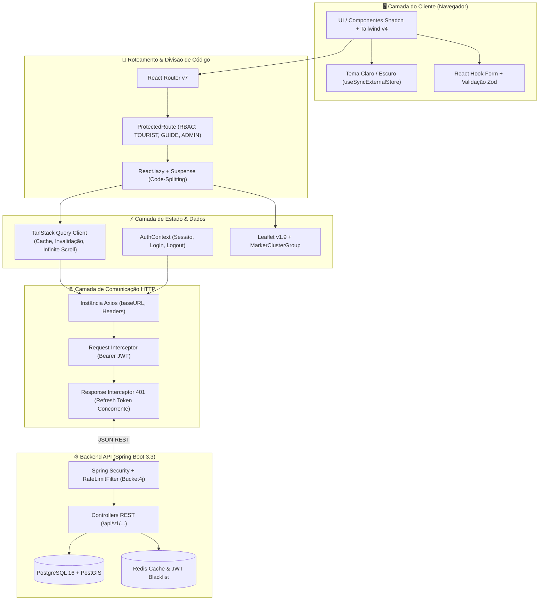
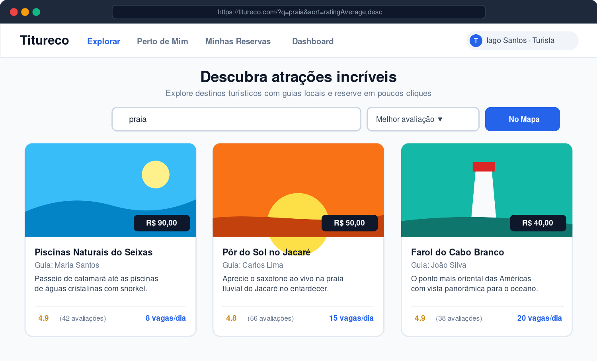
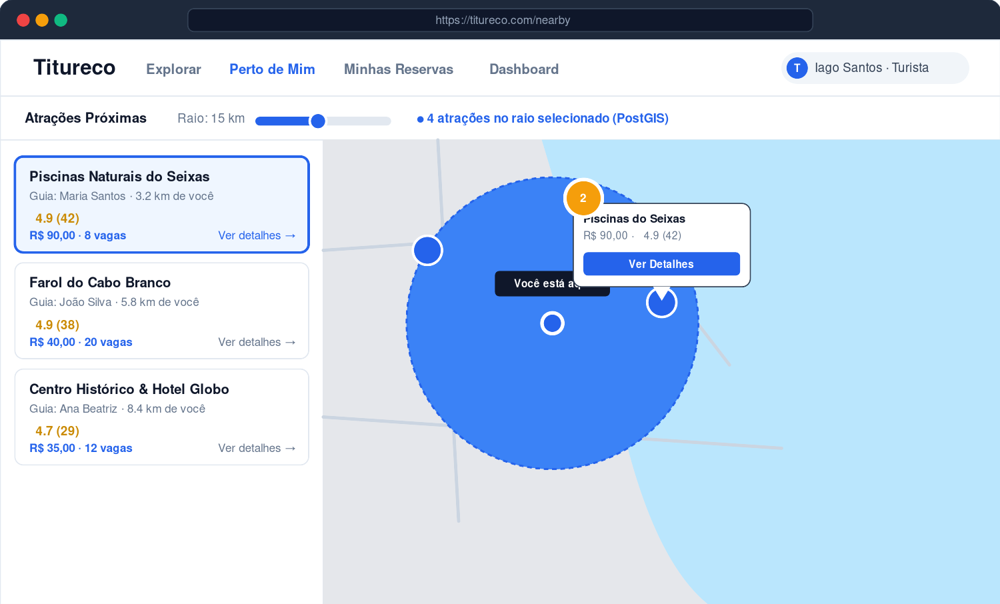
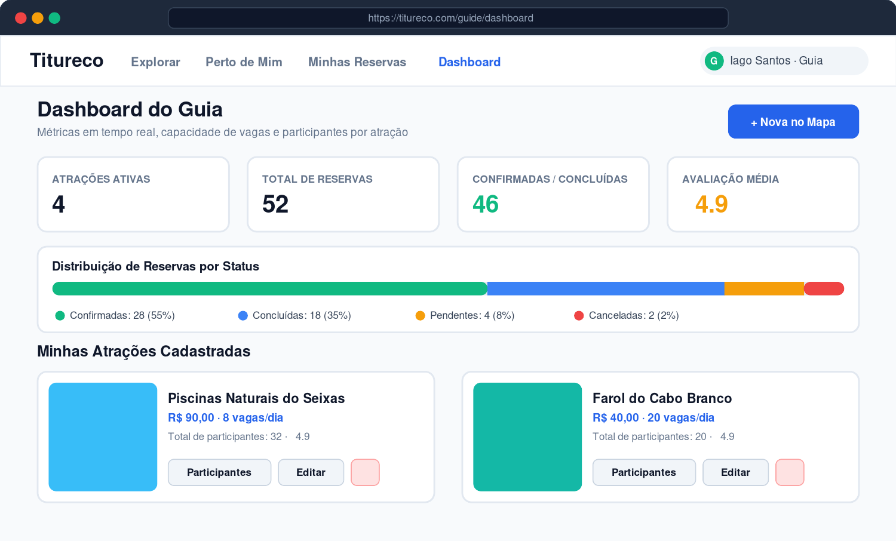
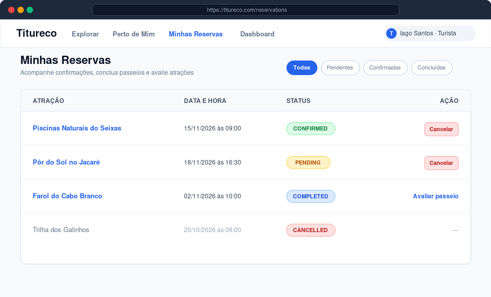
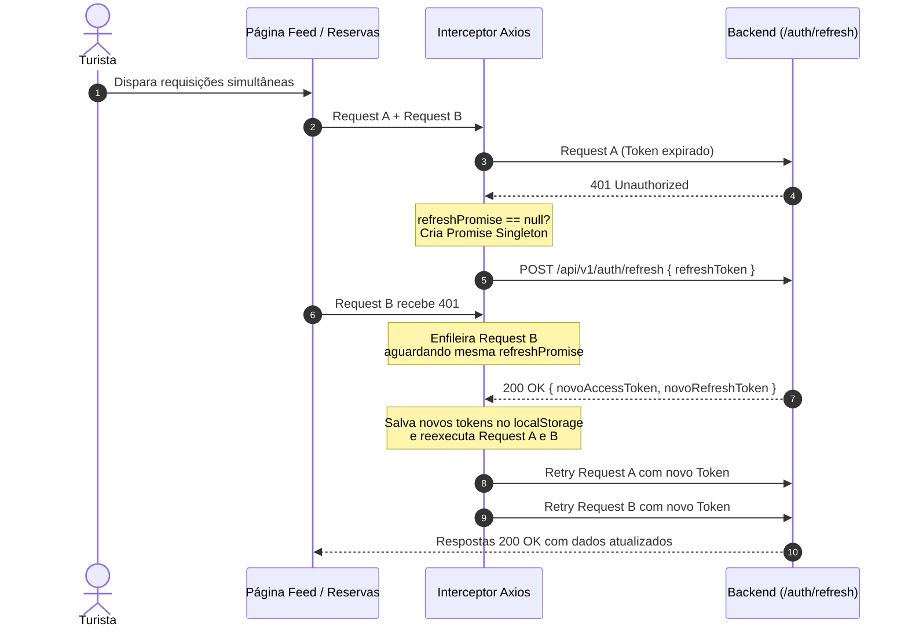

# Titureco — Frontend

[](https://react.dev/)
[](https://www.typescriptlang.org/)
[](https://vitejs.dev/)
[](https://tailwindcss.com/)
[](https://tanstack.com/query)
[](https://leafletjs.com/)

Interface web moderna, responsiva e acessível da plataforma **Titureco**, desenvolvida para conectar turistas a guias locais por meio de busca geoespacial via **PostGIS**, agendamento de passeios por data/horário, gestão operacional de participantes e avaliações com elegibilidade verificada.


---

## Sumário

1. [Visão Geral da Arquitetura](#1-visão-geral-da-arquitetura)
2. [Fluxos Principais & Telas](#2-fluxos-principais--telas)
   - [Fluxo 1: Descoberta & Filtros de Busca (Turista)](#fluxo-1-descoberta--filtros-de-busca-turista)
   - [Fluxo 2: Exploração Geoespacial "Perto de Mim"](#fluxo-2-exploração-geoespacial-perto-de-mim)
   - [Fluxo 3: Dashboard Operacional do Guia](#fluxo-3-dashboard-operacional-do-guia)
   - [Fluxo 4: Gestão de Reservas & Avaliações](#fluxo-4-gestão-de-reservas--avaliações)
   - [Fluxo 5: Painel Administrativo de Usuários](#fluxo-5-painel-administrativo-de-usuários)
3. [Destaques de Engenharia](#3-destaques-de-engenharia)
   - [TanStack Query v5 vs. useEffect Manual](#-tanstack-query-v5-vs-useeffect-manual)
   - [Interceptor Axios com Fila Concorrente de Refresh Token](#-interceptor-axios-com-fila-concorrente-de-refresh-token)
   - [Code-Splitting e Otimização do Bundle](#-code-splitting-e-otimização-do-bundle)
   - [Acessibilidade (A11y) e Semântica](#-acessibilidade-a11y-e-semântica)
4. [Estrutura do Projeto](#4-estrutura-do-projeto)
5. [Como Executar Localmente](#5-como-executar-localmente)
6. [Credenciais de Teste](#6-credenciais-de-teste)

---

## 1. Visão Geral da Arquitetura

O frontend foi projetado como uma **Single Page Application (SPA)** desacoplada, utilizando divisão de código por rota (`React.lazy`), gerenciamento de cache de servidor via **TanStack Query**, componentes semânticos estilizados com **Tailwind CSS v4** e mapas interativos via **React Leaflet v5**.

### Diagrama de Camadas da Aplicação



---

## 2. Fluxos Principais & Telas

### Fluxo 1: Descoberta & Filtros de Busca (Turista)

A tela inicial oferece uma experiência fluida de exploração com **busca em tempo real com debounce** (350 ms), ordenação persistida na URL (`?q=&sort=`) para compartilhamento de links e paginação infinita (`useInfiniteQuery`).



- **Filtros Dinâmicos:** ordenação por nome, menor preço, maior preço ou melhor avaliação média.
- **Feedback Visual:** skeletons pulsantes durante o carregamento de novos itens.
- **Acessibilidade:** cards envoltos por `<Link>` semânticos, permitindo navegação por teclado e abertura em novas abas.

---

### Fluxo 2: Exploração Geoespacial "Perto de Mim"

Utiliza a API de Geolocalização do navegador e integra com os endpoints espaciais **PostGIS** da API (`/api/v1/attractions/nearby`), calculando distâncias precisas com `ST_DWithin`.



- **Controle de Alcance:** slider interativo de raio em quilômetros com debounce para evitar requisições excessivas.
- **Geometria no Mapa:** exibe círculo de alcance translúcido e marcador de pulso `"Você está aqui"`.
- **Clustering:** agrupamento automático de marcadores próximos via `leaflet.markercluster`.
- **Sidebar Sincronizada:** ao clicar em um card lateral, o mapa centraliza suavemente na atração selecionada (`useMap().flyTo`).

---

### Fluxo 3: Dashboard Operacional do Guia

Painel dedicado para guias acompanharem métricas de desempenho, volume de reservas e gerenciarem suas atrações cadastradas.



- **Indicadores Operacionais (KPIs):** total de atrações, volume acumulado de reservas, total de confirmações/conclusões e nota média.
- **Gráfico de Status de Reservas:** barra percentual segmentada por status (`CONFIRMED`, `COMPLETED`, `PENDING`, `CANCELLED`).
- **Ações Rápidas:** acesso direto à listagem de participantes, edição de dados via modal e exclusão com confirmação.

---

### Fluxo 4: Gestão de Reservas & Avaliações

Interface organizada para turistas acompanharem passeios contratados, cancelarem agendamentos futuros e avaliarem experiências já concluídas.



- **Filtros por Estado:** botões para visualização rápida de reservas pendentes, confirmadas ou concluídas.
- **Regra de Negócio na UI:** o formulário de avaliação só é liberado para atrações em que o turista possui uma reserva `COMPLETED` (conforme exigido pela API).
- **CRUD de Reviews:** o turista pode avaliar de 1 a 5 estrelas, editar um comentário existente ou remover sua avaliação a qualquer momento.

---

### Fluxo 5: Painel Administrativo de Usuários

Acesso restrito para administradores (`/admin/users`), possibilitando o gerenciamento do ecossistema de usuários.

- **Listagem Paginada:** sincronizada com o `PageDTO` da API com controle de página anterior/próxima.
- **Promoção de Usuário:** transforma turistas em guias em um único clique via `PATCH /api/v1/users/{id}/promote-guide`.
- **Exclusão Segura:** intercepta conflitos de integridade relacional (`409 Conflict`) quando o usuário possui atrações ou reservas atreladas.

---

## 3. Destaques de Engenharia

### ⚡ TanStack Query v5 vs. useEffect Manual

Anteriormente, 6 páginas diferentes mantinham estados manuais de `useEffect`, `useState`, `loading` e `error`, gerando múltiplos re-renders e problemas de cache. A migração para **TanStack Query**:
- Centralizou o cache de requisições com `staleTime: 30s`.
- Implementou invalidação cirúrgica de cache após mutações (`queryClient.invalidateQueries`).
- Reduziu mais de 200 linhas de boilerplate de data fetching imperativo.

### 🛡️ Interceptor Axios com Fila Concorrente de Refresh Token

O access token possui TTL curto (15 minutos). Quando o token expira, múltiplas requisições paralelas podem falhar simultaneamente com `401 Unauthorized`. 

Para evitar múltiplas chamadas concorrentes ao endpoint de refresh, o interceptor implementa um padrão de **Promise Singleton**:



Se o `refreshToken` estiver expirado ou revogado no Redis, o interceptor dispara um evento customizado `window.dispatchEvent(new Event('auth:logout'))`, limpando o estado global no `AuthContext` e redirecionando para a tela de login.

---

### 📦 Code-Splitting e Otimização do Bundle

O mapa do Leaflet e seus assets representam mais de 190 KB de código minificado. Com `React.lazy` e `Suspense`, as rotas pesadas só são baixadas quando o usuário realmente navega até elas:

```
dist/assets/index-txgq9B54.js              310.25 kB │ gzip: 96.58 kB  (Bundle inicial da SPA)
dist/assets/leaflet-CRWbPGcm.js            193.69 kB │ gzip: 58.51 kB  (Carregado apenas em /nearby e /guide/map)
dist/assets/dialog-DZJ0F4to.js              52.25 kB │ gzip: 17.64 kB  (Carregado sob demanda em modais)
```

O bundle principal caiu de **604 KB em arquivo único** para **310 KB**.

---

### ♿ Acessibilidade (A11y) e Semântica

- **Navegação Semântica:** eliminação de divs clicáveis; uso estrito de `<Link>` do React Router para garantir foco por teclado, leitura de tela e suporte nativo ao menu de contexto (abrir em nova aba).
- **Controles de Avaliação:** as estrelas de review possuem atributos `aria-label="N de 5 estrelas"` e `aria-pressed` para tecnologia assistiva.
- **SEO & Internacionalização:** `index.html` com `lang="pt-BR"`, meta description, Open Graph tags e pré-renderização de tema no `<head>` para evitar flash de tema claro (*FOUC*).

---

## 4. Estrutura do Projeto

```
titureco-frontend/
├── docs/
│   └── screenshots/         # Screenshots e mockups dos fluxos para documentação
├── public/
│   ├── favicon.svg          # Ícone da aplicação
│   └── og-image.png         # Imagem de prévia para redes sociais (1200x630)
├── scripts/
│   └── generate_screenshots.py # Script gerador de mockups em alta resolução
├── src/
│   ├── assets/              # Estilos e ícones
│   ├── components/
│   │   ├── ui/              # Componentes base (Button, Card, Dialog, Table, Badge, etc.)
│   │   ├── AttractionCard.tsx  # Card da atração com skeleton exportado
│   │   ├── Navbar.tsx       # Barra de navegação com menu mobile e dark mode
│   │   ├── ProtectedRoute.tsx # Guardião de rotas com preservação de rota de retorno
│   │   └── ErrorBoundary.tsx # Captura de erros de runtime do React
│   ├── contexts/
│   │   └── AuthContext.tsx  # Sessão do usuário autenticado e integração de logout
│   ├── data/
│   │   └── attraction-images.json # Mapeamento estático de fotos por ID de atração
│   ├── lib/
│   │   ├── hooks.ts         # usePageTitle, useDebouncedValue, useMyAttractions
│   │   ├── leaflet.ts       # Setup de ícones, MarkerClusterGroup e constantes OSM
│   │   ├── theme.ts         # Hook useIsDark e sincronização de tema sem re-render
│   │   ├── utils.ts         # formatBRL e extrator de erros getErrorMessage
│   │   └── utils.test.ts    # Testes unitários com node:test nativo
│   ├── pages/
│   │   ├── admin/
│   │   │   └── AdminUsers.tsx      # Gestão de usuários, promoção e exclusão
│   │   ├── guide/
│   │   │   ├── Dashboard.tsx       # Métricas, distribuição de status e ações
│   │   │   ├── MapRegister.tsx     # Cadastro/edição de atração direto no mapa
│   │   │   └── Participants.tsx    # Confirmação e conclusão de reservas
│   │   ├── tourist/
│   │   │   ├── AttractionDetail.tsx # Detalhes, agendamento de passeio e reviews
│   │   │   ├── Feed.tsx            # Feed infinito com busca debounced e ordenação
│   │   │   ├── MyReservations.tsx  # Minhas reservas e cancelamento
│   │   │   └── NearbyMap.tsx       # Mapa de atrações próximas com raio PostGIS
│   │   ├── Login.tsx        # Formulário com React Hook Form + Zod
│   │   ├── Register.tsx     # Cadastro com validação espelhada da API
│   │   ├── Profile.tsx      # Edição de perfil (nome, email, senha)
│   │   └── NotFound.tsx     # Página 404 personalizada
│   ├── services/
│   │   └── api.ts           # Cliente Axios configurado com fila de Refresh Token
│   ├── types/
│   │   └── api.ts           # Interfaces TypeScript sincronizadas com os DTOs Java
│   ├── App.tsx              # Definição de rotas com lazy loading e Toaster
│   ├── main.tsx             # Bootstrap da aplicação com StrictMode e QueryClient
│   └── index.css            # Variáveis CSS para temas claro e escuro (.dark)
├── package.json
├── tsconfig.json
└── vite.config.ts
```

---

## 5. Como Executar Localmente

### Pré-requisitos
- **Node.js** >= 18.0.0
- **npm** >= 9.0.0
- Backend Titureco rodando em `http://localhost:8080` (consulte o repositório do backend)

### Passo a Passo

1. **Clone o repositório e acesse a pasta:**
   ```bash
   git clone https://github.com/iagovictorino/titureco-frontend.git
   cd titureco-frontend
   ```

2. **Configure as variáveis de ambiente:**
   ```bash
   cp .env.example .env
   ```
   *(O arquivo `.env.example` já aponta para `VITE_API_URL=http://localhost:8080`)*

3. **Instale as dependências:**
   ```bash
   npm install
   ```

4. **Inicie o servidor de desenvolvimento:**
   ```bash
   npm run dev
   ```
   A aplicação estará acessível em `http://localhost:5173`.

5. **Executar verificação de tipos e build de produção:**
   ```bash
   npm run build
   ```

6. **Executar testes unitários:**
   ```bash
   npm test
   ```

7. **Executar linting:**
   ```bash
   npm run lint
   ```

---

## 6. Credenciais de Teste

Para testar rapidamente os fluxos e permissões da plataforma, utilize as contas padrão criadas pelo seeder do backend:

| Perfil | E-mail | Senha | Acessos |
|---|---|---|---|
| 👑 **Administrador** | `admin@titureco.com` | `admin123` | Painel Admin (`/admin/users`), todas as atrações e reservas |
| 🗺️ **Guia** | `guia@titureco.com` | `senha123` | Dashboard (`/guide/dashboard`), cadastro no mapa e participantes |
| 🎒 **Turista** | `turista@titureco.com` | `senha123` | Explorar (`/`), mapa próximo (`/nearby`), reservas e avaliações |
